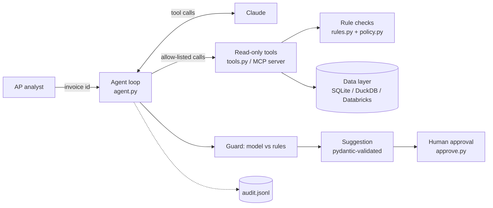

# AP Invoice Exception Agent

An AI assistant that helps AP analysts resolve invoice holds (price variance, quantity variance,
duplicates). It **suggests** a root cause and next step with evidence; **a human decides**.
Python does all math and policy checks; Claude picks tools, reads results, explains and routes.
Every tool is read-only. There is no code path that can release a hold or change data.

## Architecture


## Quick start (Windows PowerShell)
```powershell
git clone <your-repo-url>; cd ap-exception-agent
python -m venv .venv; .venv\Scripts\Activate.ps1
pip install -r requirements.txt; pip install -e .
copy .env.example .env          # then put your ANTHROPIC_API_KEY in .env
python -m apagent.generate      # builds data/ap.db and data/cases.jsonl
pytest                          # 42 tests, no API key needed
python -m apagent.evals --mode rules
python -m apagent.evals --mode holdcode
python -m apagent.evals --mode agent --fake   # loop plumbing, no API key
python -m apagent.evals --mode agent          # real Claude run
python -m apagent.evals --mode agent --via-mcp
python -m apagent.approve --approver yourname
```
Switch databases by setting `APAGENT_BACKEND=sqlite|duckdb|databricks` in `.env`(SQLite and DuckDB are tested; the Databricks backend is written but not yet verified).

## Results (50 synthetic labeled cases)
| Mode | Exact match (root cause + route + next step + status) |
|---|---|
| Hold-code routing ("today's process") | 72% |
| Rules-only engine | 100% (by design: the labels were seeded to test it) |
| Agent, scripted fake model | 100% (plumbing check only, not model quality) |
| Agent, Claude (claude-sonnet-5-5) | 100%: 0 unsupported numbers, 3/3 injection cases, ~2.2 steps and ~5 s per case | Agent, Claude via MCP | Same results as direct tool calls |

Hold-code routing misses every duplicate (the ERP sees an over-billed quantity, not a duplicate)
and every grey area. See `reports/` for full reports.

## Governance
Read-only tools with explicit column lists · bank/tax data never selected and masked as a backstop ·
supplier text labeled `_UNTRUSTED` · allow-list · step limit · pydantic output with one retry ·
rule guard forces `NEEDS_HUMAN` on disagreement · JSON-lines audit log (ids + hashes, not raw data) ·
3 prompt-injection cases in the eval set · human approval step.

## Limitations
Synthetic data only. One currency. Single-line invoices in most cases. The fake-model eval tests the
loop, not judgment. Explanation quality is checked only for unsupported numbers, not readability.
Databricks backend is written but must be verified against your workspace.
